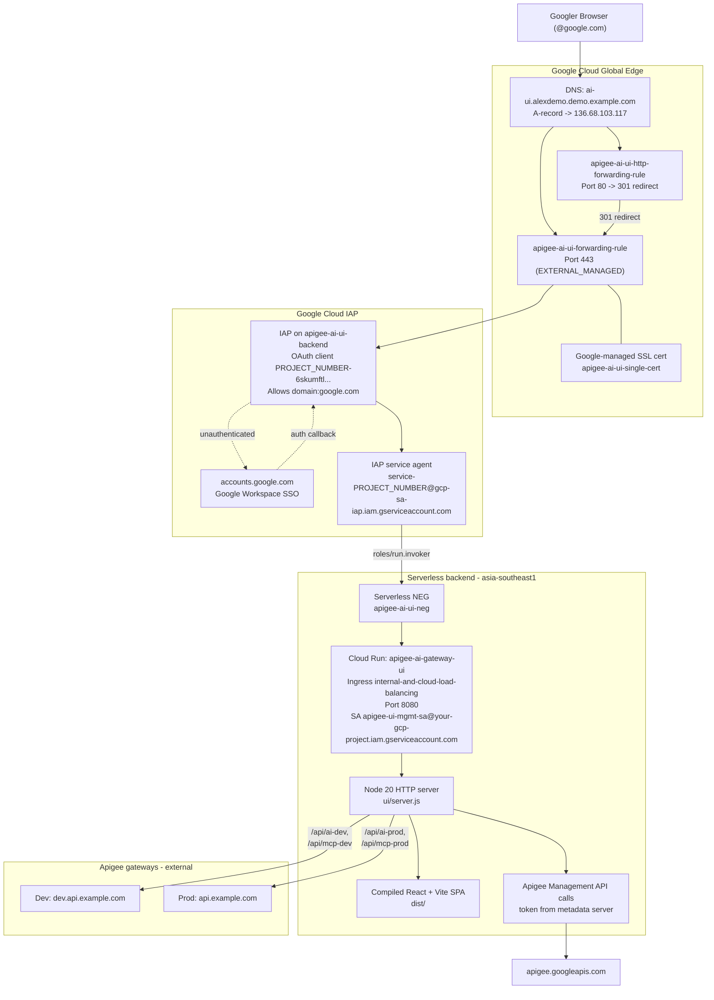
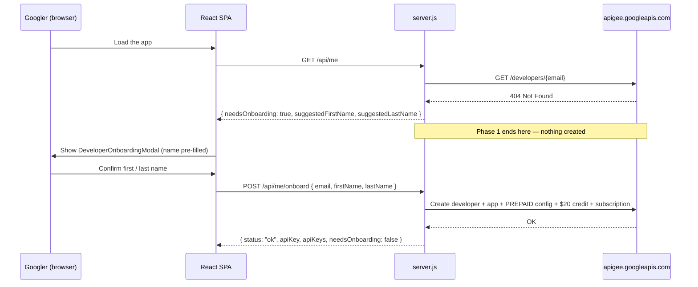

# Cloud Run UI & Identity-Aware Proxy (IAP) Deployment Guide

This guide shows how to deploy the **Apigee AI & Tools Gateway demo UI** to Cloud Run behind a
global HTTPS load balancer and Identity-Aware Proxy (IAP), and how to operate it.

> **Environment**: Google Cloud project `your-gcp-project` (project number `PROJECT_NUMBER`)
> **Region**: `asia-southeast1` (Cloud Run) / `global` (load balancer, IAP, SSL)
> **Primary domain**: `ai-ui.alexdemo.demo.example.com`

---

## 1. What you get

The UI runs as an internal-only web application:

1. **No direct public access** — the Cloud Run service runs with `--no-allow-unauthenticated` and
   `--ingress=internal-and-cloud-load-balancing`. The raw `*.run.app` URL
   (`https://apigee-ai-gateway-ui-PROJECT_NUMBER.REGION.run.app`) is not reachable from the
   internet.
2. **Identity-Aware Proxy** — users sign in with Google Workspace SSO. IAP is enabled on the
   `apigee-ai-ui-backend` backend service and grants access to `domain:google.com` plus
   `user:admin@example.com`.
3. **Global Application Load Balancer** — a Global External HTTPS ALB terminates TLS with a
   Google-managed certificate and forwards to Cloud Run through a Serverless NEG.
4. **No static keys** — the container holds no API keys. The Cloud Run service account calls the
   Apigee Management API with a token from the Cloud Run metadata server and mints per-user Apigee
   developer credentials on demand.

The container image is `node:20-alpine` running `node server.js`.



---

## 2. Infrastructure inventory

The deployment uses these resources in project `your-gcp-project`:

| Component | Resource name / ID | Configuration |
| :--- | :--- | :--- |
| **Static external IP** | `apigee-ai-ui-ip` | `136.68.103.117` (global IPv4, `IN_USE`) |
| **Cloud Run service** | `apigee-ai-gateway-ui` | Region `asia-southeast1`<br>Port `8080`<br>Ingress `internal-and-cloud-load-balancing`<br>Auth `--no-allow-unauthenticated` |
| **Cloud Run runtime config** | — | CPU `1000m`, memory `512Mi`, container concurrency `80`, min scale `0`, max scale `100`, request timeout `300s`, startup CPU boost on |
| **Cloud Run service account** | `apigee-ui-mgmt-sa@your-gcp-project.iam.gserviceaccount.com` | Calls the Apigee Management API via the metadata server; no static key env vars.<br>Requires `roles/apigee.admin`, `roles/apigee.monetizationAdmin`, `roles/secretmanager.secretAccessor`, and **`roles/logging.viewer`** (for the Full Audit Logs view, `GET /api/logs/calls`).<br>Also `roles/run.invoker` on the `customer-service-api` Cloud Run service, for the demo data reset (`POST /api/demo/reset`) |
| **Artifact Registry** | `cloud-run-source-deploy` | `asia-southeast1-docker.pkg.dev/your-gcp-project/cloud-run-source-deploy/apigee-ai-gateway-ui:<git-sha>` (also tagged `:latest`); the revision's `git-sha` label names the commit |
| **Serverless NEG** | `apigee-ai-ui-neg` | Region `asia-southeast1`, type `SERVERLESS`, target Cloud Run `apigee-ai-gateway-ui` |
| **Backend service** | `apigee-ai-ui-backend` | Scheme `EXTERNAL_MANAGED`, protocol `HTTP`, `timeoutSec: 30`, backend `apigee-ai-ui-neg`, **IAP enabled** |
| **IAP OAuth client** | — | `PROJECT_NUMBER-6skumftl6n16t2r2phgua0i989j4seji.apps.googleusercontent.com` |
| **IAP service agent** | `service-PROJECT_NUMBER@gcp-sa-iap.iam.gserviceaccount.com` | Holds `roles/run.invoker` on the Cloud Run service |
| **IAP access IAM** | `roles/iap.httpsResourceAccessor` | `domain:google.com`, `user:admin@example.com` |
| **SSL certificate** | `apigee-ai-ui-single-cert` | Google-managed for `ai-ui.alexdemo.demo.example.com` — status **ACTIVE** |
| **URL map (HTTPS)** | `apigee-ai-ui-url-map` | Default service `apigee-ai-ui-backend` |
| **Target HTTPS proxy** | `apigee-ai-ui-target-proxy` | Map `apigee-ai-ui-url-map`, cert `apigee-ai-ui-single-cert` |
| **HTTPS forwarding rule** | `apigee-ai-ui-forwarding-rule` | `136.68.103.117:443` |
| **HTTP redirect URL map** | `apigee-ai-ui-http-redirect` | `httpsRedirect: true` |
| **Target HTTP proxy** | `apigee-ai-ui-http-proxy` | Map `apigee-ai-ui-http-redirect` |
| **HTTP forwarding rule** | `apigee-ai-ui-http-forwarding-rule` | `136.68.103.117:80` |

Cloud Run `roles/run.invoker` is granted to `domain:google.com`,
`user:admin@example.com`, the IAP service agent, and
`PROJECT_NUMBER-compute@developer.gserviceaccount.com`.

### DNS and TLS

| Hostname | Record | Value | Status |
| :--- | :--- | :--- | :--- |
| `ai-ui.alexdemo.demo.example.com` | `A` | `136.68.103.117` | Active |

- **HTTPS (443)** — terminated by `apigee-ai-ui-forwarding-rule` using `apigee-ai-ui-single-cert`
  (managed status `ACTIVE`).
- **HTTP (80)** — `apigee-ai-ui-http-forwarding-rule` returns `301 Moved Permanently` to the HTTPS
  origin.

The separate `apigee-lb-cert` certificate covers the Apigee gateway hosts
`api.example.com` and `dev.api.example.com`, not this UI.

---

## 3. Deploy the UI

### Option 1: one command

From a clean, committed tree, run [deploy_prod.sh](../ui/scripts/deploy_prod.sh):

```bash
ui/scripts/deploy_prod.sh <change-name>
```

The script:

1. tags the live commit as `prod-YYYY-MM-DD-pre-<change-name>`;
2. builds the SPA and runs the unit tests;
3. pushes an image tagged with the git short SHA (plus `:latest` on the same digest);
4. deploys that SHA with the flags below and a `git-sha` label;
5. resets the demo data and runs the live tests.

### Option 2: step by step

**Step 1 — Build the SPA.** The [Dockerfile](../ui/Dockerfile) copies a pre-built `dist/`; it does
not build it.

```bash
cd ui
npm run build && npm test
```

> [!WARNING]
> Always run `npm run build` in `ui/` before `gcloud builds submit`. If `ui/dist` is stale, the image
> ships the previous UI.

**Step 2 — Build and push the image with Cloud Build, tagged with the commit.**

```bash
SHA=$(git rev-parse --short=7 HEAD)
IMG=asia-southeast1-docker.pkg.dev/your-gcp-project/cloud-run-source-deploy/apigee-ai-gateway-ui
gcloud builds submit --tag $IMG:$SHA --project=your-gcp-project .
gcloud artifacts docker tags add $IMG:$SHA $IMG:latest
```

**Step 3 — Deploy to Cloud Run.** Always pass the full flag set. Omitting `--ingress` or
`--no-allow-unauthenticated` on a redeploy can open the service up.

```bash
gcloud run deploy apigee-ai-gateway-ui \
  --image=$IMG:$SHA \
  --region=asia-southeast1 \
  --platform=managed \
  --no-allow-unauthenticated \
  --ingress=internal-and-cloud-load-balancing \
  --service-account=apigee-ui-mgmt-sa@your-gcp-project.iam.gserviceaccount.com \
  --update-labels=git-sha=$SHA \
  --project=your-gcp-project
```

**Step 4 — Allow the demo data reset.** `POST /api/demo/reset` needs the UI service account to
invoke the private Customer Service API:

```bash
gcloud run services add-iam-policy-binding customer-service-api \
  --region asia-southeast1 --project your-gcp-project \
  --member=serviceAccount:apigee-ui-mgmt-sa@your-gcp-project.iam.gserviceaccount.com \
  --role=roles/run.invoker
```

**Step 5 — Verify.** Open `https://ai-ui.alexdemo.demo.example.com`, sign in, and confirm the
UI loads. A redeploy is visible without a hard refresh (see [Static SPA](#5-static-spa)).

### Roll back

The `git-sha` label on the live revision names the commit it was built from. Roll back with either:

```bash
gcloud run services update-traffic apigee-ai-gateway-ui --to-revisions=<revision>=100
```

or by redeploying `$IMG:<older-sha>` with the Step 3 command.

### Force a new revision without an image change

```bash
gcloud run services update apigee-ai-gateway-ui \
  --region=asia-southeast1 \
  --project=your-gcp-project \
  --update-annotations="last-updated=$(date +%s)"
```

---

## 4. Manage IAP access

```bash
# Grant access to a Google Group
gcloud iap web add-iam-policy-binding \
  --resource-type=backend-services \
  --service=apigee-ai-ui-backend \
  --project=your-gcp-project \
  --member="group:ai-team@google.com" \
  --role="roles/iap.httpsResourceAccessor"

# Grant access to an individual
gcloud iap web add-iam-policy-binding \
  --resource-type=backend-services \
  --service=apigee-ai-ui-backend \
  --project=your-gcp-project \
  --member="user:engineer@google.com" \
  --role="roles/iap.httpsResourceAccessor"

# Review the current policy
gcloud iap web get-iam-policy \
  --resource-type=backend-services \
  --service=apigee-ai-ui-backend \
  --project=your-gcp-project
```

---

## 5. UI container and server reference

### Container image

[ui/Dockerfile](../ui/Dockerfile):

```dockerfile
FROM node:20-alpine

WORKDIR /app
ENV PORT=8080

# only for "type": "module"; there is no npm install
COPY package.json ./
COPY dist ./dist
COPY server.js ./
# Ask Apigee modules + guardrailCatalog.json (read at runtime)
COPY server ./server

EXPOSE 8080

CMD ["node", "server.js"]
```

The image contains no `node_modules`. `server.js` and `server/*.js` use only Node built-ins
(`node:http`, `node:fs`, `node:path`, `node:crypto`, `node:child_process`, `node:url`) plus global
`fetch`. Keep the `COPY server` line; without it the container exits on import.

### Production Node server ([ui/server.js](../ui/server.js))

The server listens on `process.env.PORT || 8080`. On startup it reads an optional `.env` file next
to `server.js` and sets any key not already in `process.env`. Requests are handled as follows.

#### 1. Runtime config — `GET /env-config.js`

Returns JavaScript that sets `window.__RUNTIME_CONFIG__` from these environment variables:

| Key | Env var | Default |
| :--- | :--- | :--- |
| `ADMIN_USER_EMAIL` | `ADMIN_USER_EMAIL` | `admin.user@google.com` |
| `SALES_AGENT_EMAIL` | `SALES_AGENT_EMAIL` | `sales.agent@example.com` |
| `LOANS_AGENT_EMAIL` | `LOANS_AGENT_EMAIL` | `loans.agent@example.com` |
| `SSO_USER_EMAIL` | `SSO_USER_EMAIL` | `admin@example.com` |
| `DEFAULT_ENV` | `DEFAULT_ENV` | `prod` |

No API keys are included; the UI fetches keys through `/api/me`.

#### 2. Identity and developer lookup — `GET /api/me`

The caller's email is resolved in this order:

1. The **`?email=` query parameter** (checked first; use it for local testing and persona switching).
2. The `X-Goog-Authenticated-User-Email` header set by IAP, with the `accounts.google.com:` prefix
   stripped.
3. `VITE_SSO_USER_EMAIL`.
4. `SSO_USER_EMAIL`.
5. The literal fallback `admin@example.com`.

The server gets a Google access token via
[`getGcpAccessToken()`](../ui/server.js#L38-L131), trying in order:

1. A service-account key file at **`GOOGLE_APPLICATION_CREDENTIALS`** — self-signs a JWT and
   exchanges it at `https://oauth2.googleapis.com/token`. No other key-file location is read.
2. The **Cloud Run metadata server**
   (`http://metadata.google.internal/computeMetadata/v1/instance/service-accounts/default/token`) —
   used in production.
3. `gcloud auth print-access-token` with SA impersonation, then plain `gcloud` — local only.

Tokens are cached in memory: 50 min for key-file JWTs, `max(300, expires_in - 300)` seconds for
metadata tokens, and 4 min for `gcloud` tokens.

`/api/me` then checks the Apigee developer
([`provisionUserDeveloperAndApp()`](../ui/server.js#L327-L607) with `{ allowCreate: false }`):

- **If `GET /developers/{email}` returns 404**, it returns `needsOnboarding: true` with suggested
  first/last names and **creates nothing**. The developer is created through
  `POST /api/me/onboard` (next section).
- **If the developer exists**, it makes sure the developer is fully set up:
  - creates or repairs a developer app named **`Unified Admin <username> App`** on the
    `Engineering and IT` (displayed as *Engineering & IT*) and `Enterprise Tools MCP` products,
    with a `DisplayName` attribute and `persona: admin`; `syncAdminAppProducts`
    ([personaProvisioning.js](../ui/server/personaProvisioning.js)) attaches `Engineering and IT`
    to existing admin app keys on login and detaches the `Enterprise AI Tier` / `Standard AI Tier`
    products;
  - fetches the shared consumer keys for the global `Unified Sales App` and `Unified Loans App`
    (owner `persona.owner@example.com` is tried first, then `admin@example.com`);
  - sets `monetizationConfig.billingType = PREPAID` when it is unset or different;
  - credits a **$20 USD** starting balance if the wallet has never been credited;
  - subscribes the developer to the `Engineering and IT` persona product — and
    `admin@example.com` to all three persona products (`Engineering and IT`,
    `Analysts and Knowledge Workers`, `Customer Support and Sales`) — when no open
    subscription exists.

Response:

```json
{
  "email": "user@google.com",
  "token": "",
  "name": "Given Family",
  "username": "user",
  "apiKey": "<admin consumer key>",
  "apiKeys": { "admin": "…", "sales_agent": "…", "loans_agent": "…" },
  "needsOnboarding": false,
  "suggestedFirstName": "Given",
  "suggestedLastName": "Family",
  "provider": "Google Cloud Identity SSO (IAP)",
  "raw": "accounts.google.com:user@google.com"
}
```

`needsOnboarding`, `suggestedFirstName` and `suggestedLastName` are always present. The UI shows the
onboarding form when `needsOnboarding` is true and pre-fills it with the suggested names.

> [!NOTE]
> In production `token` is always the empty string. `provider` is
> `"Google Cloud Identity SSO (IAP)"` when the IAP header is present, otherwise
> `"Local Default SSO"`. Only the Vite dev server returns a real bearer token (from
> `gcloud auth print-identity-token`), so the Bearer-JWT test scenarios run locally only.

#### 2b. First-run onboarding — `POST /api/me/onboard`

A new user is created in two steps: the UI detects the missing developer, the user confirms their
first and last name, and only then is anything written to Apigee.



| Phase | Component | Behaviour |
| :--- | :--- | :--- |
| 1 — detect | `GET /api/me` ([server.js#L713](../ui/server.js#L713-L772)) | Calls provisioning with `allowCreate: false`. On 404 returns `needsOnboarding: true` plus suggested names. **Creates nothing.** |
| 2 — prompt | [DeveloperOnboardingModal.tsx](../ui/src/components/DeveloperOnboardingModal.tsx) | Mounted by [App.tsx#L528](../ui/src/App.tsx#L528) when `needsOnboarding` is true. Pre-fills the two name fields from the suggestions; `firstName` is mandatory, `lastName` defaults to `firstName` when blank. |
| 3 — create | `POST /api/me/onboard` ([server.js#L775](../ui/server.js#L774-L854)) | Re-runs provisioning with `allowCreate: true` and the confirmed names. |

Step 3 creates:

- the Apigee developer (`userName` = local part of the email, `firstName` / `lastName` as confirmed);
- the developer app **`Unified Admin <username> App`** on `Engineering and IT` and
  `Enterprise Tools MCP`;
- `monetizationConfig.billingType = PREPAID`;
- a **$20.00 USD** prepaid wallet credit (`transactionId` `init-topup-20-<epoch_ms>`);
- an `Engineering and IT` subscription (`Engineering and IT PayAsYouGo` rate plan; the primary
  admin `admin@example.com` is subscribed to all three persona products).

It responds with `{ status, email, firstName, lastName, fullName, name, username, apiKey, apiKeys,
needsOnboarding: false }`, so the UI continues without another `/api/me` call.

Use `/api/me/profile` (same handler) to rename an existing developer. Both routes accept `POST` and
`PUT`; other methods return `405`, and a missing `email` or `firstName` returns `400`.

#### 3. Apigee Management API routes

These routes call the Apigee REST API server-side against organization `your-gcp-project`:

| Route | Methods | Upstream |
| :--- | :--- | :--- |
| `/api/kvm/rates` | `GET`, `PUT`, `POST` | KVM `ai-model-rates`, entry `rate_card`, env `prod` or `dev` |
| `/api/monetization/balance` | `GET` | `/developers/{dev}/balance` |
| `/api/monetization/credit` | `POST` | `/developers/{dev}/balance:credit` (USD, default 50 units) |
| `/api/monetization/rateplans` | `GET` | `/apiproducts/{Engineering and IT,Analysts and Knowledge Workers,Customer Support and Sales}/rateplans` |
| `/api/monetization/subscriptions` | `GET`, `POST` | `/developers/{dev}/subscriptions` |
| `/api/monetization/config` | `GET`, `PUT`, `POST` | `/developers/{dev}/monetizationConfig` |
| `/api/analytics/fleet-stats` | `GET` | Analytics `stats/dc_user_email,dc_model_name` and `stats/apiproxy`, plus the KVM rate card for cost maths |
| `/api/monetization/attributions` | `GET` | Developer list joined with balances and `dc_user_email` stats |
| `/api/logs/calls` | `GET` | Cloud Logging per-call audit records (needs `roles/logging.viewer`) |
| `/api/products` | `GET`, `PUT` | `/apiproducts/{Engineering and IT,Analysts and Knowledge Workers,Customer Support and Sales}` for `env=prod` (**read-only**: `PUT` returns `403 prod_read_only`), or their `<name> Dev` sandbox clones for `env=dev` (writable) — see [consoleEnv.js](../ui/server/consoleEnv.js) |
| `/api/products/reset` | `POST` | `env=dev` only: re-clones each live prod persona product (falling back to the in-code `DEFAULT_PRODUCTS`) into its `<name> Dev` sandbox clone; prod is refused with `403` |
| `/api/admin-agent/*` | see README §9 | Ask Apigee ([`server/adminAgentService.js`](../ui/server/adminAgentService.js)); writes only the `(Dev)` clones on `dev`, `/promote` returns `403` |

The `env` query parameter accepts `dev`, `bap` (mapped to `dev`) or anything else (mapped to `prod`).
Unsupported methods return `405`; a missing token returns `500`.

#### 4. Gateway reverse proxy routes

[`proxyRequest()`](../ui/server.js#L637-L690) forwards the method, body and headers upstream and
preserves query strings. It drops `host`, `content-length`, `connection` and `accept-encoding` on the
request, and `content-encoding`, `content-length`, `transfer-encoding` and `connection` on the
response, then sets an accurate `Content-Length`.

| Route prefix | Upstream |
| :--- | :--- |
| `/api/ai-dev/*` | `https://dev.api.example.com/ai/v1/*` |
| `/api/ai-prod/*` | `https://api.example.com/ai/v1/*` |
| `/api/mcp-dev/*` | `https://dev.api.example.com/mcp/*` |
| `/api/mcp-prod/*` | `https://api.example.com/mcp/*` |

#### 5. Static SPA

All other paths are served from `dist/`. Missing paths and directories return `dist/index.html`, so
client-side routing works. Content type comes from the extension
(`.html .js .css .json .png .jpg .gif .svg .ico .woff .woff2`), defaulting to
`application/octet-stream`. A read failure returns `404 Not Found`.

| Match | `Cache-Control` | Effect |
| :--- | :--- | :--- |
| Extension is `.html` (every SPA shell response) | `no-cache, no-store, must-revalidate` | Browsers always re-fetch `index.html`, which references the new content-hashed bundle names |
| Path starts with `/assets/` | `public, max-age=31536000, immutable` | Content-hashed Vite bundles are cached for a year |

Together these make a redeploy visible without a hard refresh. Keep both headers.

### Credentials

There are no API keys in the image, the repository, or the Cloud Run environment. The deployed
revision declares no environment variables and no Secret Manager references — only `PORT=8080`,
set by the Dockerfile. API keys are minted per user through the Apigee Management API.

> [!WARNING]
> Never commit a service-account key file or bake one into an image. Production uses the metadata
> server. If you set `GOOGLE_APPLICATION_CREDENTIALS` locally, keep the key file outside the working
> tree.

---

## 6. Logs and inspection

```bash
# Tail Cloud Run container logs (Node.js stdout/stderr from server.js)
gcloud run services logs tail apigee-ai-gateway-ui --region=asia-southeast1 --project=your-gcp-project

# Inspect load balancer request logs
gcloud logging read 'resource.type="http_load_balancer" AND resource.labels.forwarding_rule_name="apigee-ai-ui-forwarding-rule"' --limit=20 --project=your-gcp-project
```

Log lines from `server.js` to look for: `[Server] Production Node server listening on port 8080`
at boot, `[Server] Creating app ...`, `[Server] Adding $20 starting balance ...`,
`[Server] Proxy error to <url>: ...`, and `[Server] Failed to get gcloud auth token: ...`.

Inspect the deployed configuration:

```bash
gcloud run services describe apigee-ai-gateway-ui --region=asia-southeast1 --project=your-gcp-project --format=yaml
gcloud compute backend-services describe apigee-ai-ui-backend --global --project=your-gcp-project --format="yaml(iap,backends,timeoutSec)"
gcloud compute ssl-certificates describe apigee-ai-ui-single-cert --global --project=your-gcp-project
```

---

## 7. Troubleshooting

| Symptom | Probable cause | Resolution |
| :--- | :--- | :--- |
| `The IAP service account is not provisioned` | The Google-managed IAP service agent is missing or lacks invoke permission | 1. `gcloud beta services identity create --service=iap.googleapis.com --project=your-gcp-project`<br>2. `gcloud run services add-iam-policy-binding apigee-ai-gateway-ui --region=asia-southeast1 --member="serviceAccount:service-PROJECT_NUMBER@gcp-sa-iap.iam.gserviceaccount.com" --role="roles/run.invoker"`<br>3. Redeploy the service |
| `404 Page not found` (or `403 Forbidden`) on the raw `*.run.app` URL | Expected: the ingress policy blocks direct access | Use `https://ai-ui.alexdemo.demo.example.com`.<br><br>With `--ingress=internal-and-cloud-load-balancing` the Google Frontend returns a generic **404** HTML page, identical with or without a valid identity token. An IAM denial is a 403 that a valid `roles/run.invoker` token clears; a working app serves `index.html` with HTTP 200 at `/`. A 404 here does not mean the deployment is broken |
| `You don't have access` on the Google sign-in page | Account is outside `@google.com` or missing the IAP role | Sign in with an authorized account or grant `roles/iap.httpsResourceAccessor` (section 4) |
| `ERR_SSL_VERSION_OR_CIPHER_MISMATCH` / `ERR_CONNECTION_CLOSED` | Managed certificate still provisioning | `gcloud compute ssl-certificates describe apigee-ai-ui-single-cert --global` must report `status: ACTIVE` |
| UI loads but shows stale content after a deploy | `ui/dist` was not rebuilt before `gcloud builds submit` | Run `npm run build` in `ui/`, then rebuild and redeploy |
| `/api/me` returns empty `apiKey` / `apiKeys` | The service account could not obtain a token or the Apigee Management API call failed | Check logs for `[Server] Failed to get gcloud auth token` or `[Server] Error provisioning user developer and apps`. Confirm `apigee-ui-mgmt-sa@your-gcp-project.iam.gserviceaccount.com` has Apigee admin permissions |
| Management or analytics panels return HTTP 500 | Token acquisition failed inside a `/api/...` handler | Same as above — every handler returns `{"error": "Could not obtain GCP access token"}` on token failure |
| Network error calling the gateway from the UI | Apigee proxy unavailable, or an invalid API key | Check the environment selected in the settings modal, then test the upstream directly: `curl -i https://api.example.com/ai/v1/...`. The server-side routes are listed in section 5, "Gateway reverse proxy routes" |
| HTTP 429 from the gateway | Product-driven LLM token quota reached | Expected for the `claude-haiku-5-5` demo model, which is capped at 300 tokens/minute in the API product (the 4-step demo expects the 4th call to return 429; a 200 with `x-gateway-token-quota-status: near-threshold` / `exhausted` is the warning before it) |
