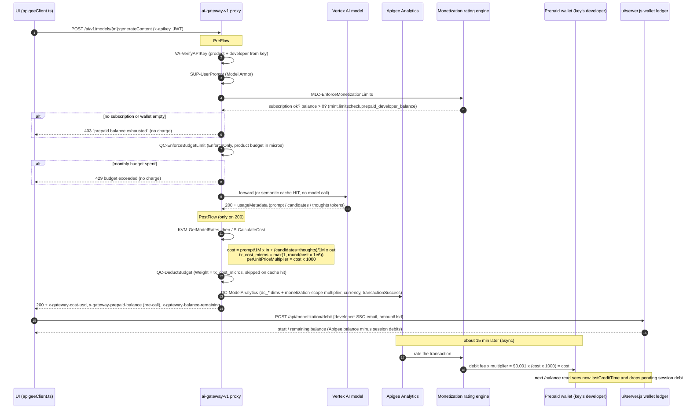

# How the AI Gateway prepaid wallet works

This page explains how an AI Gateway call is priced and charged to an Apigee Monetization prepaid
wallet, and how to top up and observe the wallet. Values below come from the live Apigee org
`your-gcp-project`.

## Summary

- **One price, three ledgers.** The proxy prices every successful call once, in
  [CalculateCost.js](../apigee/proxies/ai-gateway-v1/apiproxy/resources/jsc/CalculateCost.js):
  tokens × the model's rate from the `ai-model-rates` KVM. That number is applied to:
  1. **Prepaid wallet** (Apigee Monetization). Debited **asynchronously**, about 15 min later,
     from Analytics.
  2. **Budget counter** (Quota policy, micro-dollars). Deducted **synchronously**, on the same call.
  3. **Analytics** (custom dimensions). Feeds the Analytics & Cost dashboards.
- **Which wallet:** the wallet of the **developer who owns the API key's app**, which is not
  necessarily the signed-in user.
- **Live balance in the UI:** `ui/server.js` keeps a per-session debit ledger and subtracts it from
  the balance Apigee reports, so the balance chips move on every call instead of waiting for
  settlement.

## Per-call sequence

A call is blocked before reaching the model when:

- the developer has no subscription or the wallet is empty: **403** from
  `MLC-EnforceMonetizationLimits` ("prepaid balance exhausted");
- the monthly budget is spent: **429** from `RF-BudgetExceeded`.

Blocked calls are not charged.

## How a call is priced

Every persona product has a published rate plan, `<Product> PayAsYouGo`: `MONTHLY`, `USD`,
`FIXED_PER_UNIT`, fee **$0.001** per unit (`nanos: 1000000`). Each developer's `monetizationConfig`
is `billingType: PREPAID`.

Monetization charges `fee × perUnitPriceMultiplier`. The proxy sets the multiplier to
`cost × 1000`, so the wallet is debited exactly the model cost.

**Worked example:** `gemini-3.1-pro-preview` at $2.00 in / $12.00 out per 1M tokens, with
1,000 prompt tokens and 500 output tokens (candidates + thoughts).

| Step | Value |
| --- | --- |
| Input cost | 1,000 / 1M × $2.00 = $0.00200 |
| Output cost | 500 / 1M × $12.00 = $0.00600 |
| `flow.tx_cost_usd` → `x-gateway-cost-usd` | **$0.008000** |
| `perUnitPriceMultiplier` | 8.00 |
| Wallet debit (async) | $0.001 × 8.00 = **$0.00800** |
| Budget counter weight (sync) | 8,000 micros |
| UI session debit | $0.00800 against the SSO user's ledger |

Thinking tokens are billed at the **output** rate.

## What is charged, and where

| Call outcome | Wallet (Monetization) | Budget counter | Analytics / dashboards | UI live balance |
| --- | --- | --- | --- | --- |
| 200, model call, priced | **cost** | cost (micros, min 1) | tokens + model (**cost**) | − cost |
| 200, semantic cache **HIT** | $0 (`transactionSuccess=false`, multiplier 0) | skipped | tokens, `dc_cache_status=HIT` (**$0.00**) | − $0 |
| 200, model not listed in the rate card | **cost at the card's `default` rate** (live: $0.15 in / $0.60 out per 1M, tier medium) | cost (micros, min 1) | tokens + model | − cost |
| 200 but the rate card could not be read (KVM missing, invalid JSON, no `default` entry) | $0 (`transactionSuccess=false`) | skipped | recorded, `x-gateway-cost-source` names the gap | − $0 |
| Any fault: 401 key / product, 400 Model Armor, 403 MLC, 429 budget or token quota, upstream error | $0 (fault path omits monetization collectors) | not deducted | `DC-FaultAnalytics` row | no debit |
| **MCP tool call** (`/mcp`, tools proxies) | **$0**: the MCP proxies have no monetization policies | n/a (per-tool call quotas instead) | tool analytics | no debit |

Only AI Gateway (`ai-gateway-v1`) calls are charged to the wallet. MCP tool calls are limited by
per-tool call quotas on the MCP products.

## The three ledgers side by side

| | Prepaid wallet | Budget counter | Analytics |
| --- | --- | --- | --- |
| Owner | Apigee Monetization, per **developer** | Quota `developer-budget-counter`, per **developer id** | Apigee Analytics |
| Limit | Wallet balance (top-ups) | Product attribute `developer.budget.limit`, live: Eng & IT $20, Analysts $10, Support & Sales $5 per month | none |
| Timing | Async, ~15 min | Sync, same call | Async, minutes |
| Block | 403 from `MLC-EnforceMonetizationLimits` | 429 from `RF-BudgetExceeded` | none |
| Shown in UI | Monetization tab balance, trace "prepaid balance" chips | `x-gateway-budget-*` headers | Analytics & Cost, Agent Analytics |

## Starting credit and top-ups

- Every new developer starts with **$20** in the wallet, credited by
  `provision_unified_credentials.py` and by the UI's onboarding path
  (`PREPAID_STARTING_BALANCE_USD`). This is separate from the monthly budget counter.
- To add funds, call `POST /api/monetization/credit`, which credits
  `/developers/{dev}/balance:credit` (USD, default 50 units).
- A top-up changes Apigee's `lastCreditTime`; the UI then drops its pending session debits and
  shows Apigee's balance.

## Observe the wallet

**Response headers** on every successful AI Gateway call:

| Header | Meaning |
| --- | --- |
| `x-gateway-cost-usd` | Cost of this call (0 on a cache hit) |
| `x-gateway-prepaid-balance` | Wallet balance **before** the call, as read by MLC; lags settlement |
| `x-gateway-balance-remaining` | `x-gateway-prepaid-balance` minus this call |
| `x-gateway-budget-*` | Budget counter status |

When the UI server can read Apigee, the UI replaces the two balance headers with its session-ledger
values.

**UI server endpoints:**

- **`GET /api/monetization/balance?dev=`** returns the Apigee wallet balance minus that developer's
  pending session debits
  ([walletLedger.js](../ui/server/walletLedger.js) `applyLedgerToBalance`).
- **`POST /api/monetization/debit`** is called by
  [apigeeClient.ts](../ui/src/services/apigeeClient.ts#L336-L361) after every 2xx with
  `x-gateway-cost-usd` (0 on a cache hit). It returns start and remaining balances.
- When Apigee's `lastCreditTime` changes (settlement or top-up), pending debits are dropped,
  because Apigee's balance now includes them.
- The ledger is held in memory. After a Cloud Run restart, or on a second instance, the live
  balance shows Apigee's figure until the next settlement; the next Apigee read is correct.

**In the UI:** the Monetization tab shows the wallet balance; trace "prepaid balance" chips show the
balance per call; Analytics & Cost and Agent Analytics show spend from Analytics.

## Persona keys and the signed-in user

- The Sales and Loans keys belong to one persona developer (`persona.owner@example.com`), so Apigee
  debits that wallet.
- The UI's live session debit is keyed by the signed-in SSO email. For Admin-key calls both are the
  same wallet. For persona calls the live chip moves on the SSO user's wallet until settlement.
- In a deployment where each user has their own app, key and wallet, the key owner and the
  signed-in user are the same.

## Where it lives

| Piece | File |
| --- | --- |
| Flow order | `apigee/proxies/ai-gateway-v1/apiproxy/proxies/default.xml` |
| Wallet gate | `policies/MLC-EnforceMonetizationLimits.xml` |
| Budget gate / deduct | `policies/QC-EnforceBudgetLimit.xml`, `policies/QC-DeductBudget.xml` |
| Pricing and multiplier | `resources/jsc/CalculateCost.js` |
| Rating record | `policies/DC-ModelAnalytics.xml` (success), `policies/DC-FaultAnalytics.xml` (faults, no monetization) |
| Response headers | `policies/AM-SetResponseHeaders.xml` |
| Rate plans, prepaid config, top-up | `apigee/scripts/provision_unified_credentials.py` (`sync_monetization`), `ui/server.js` `/api/me/onboard` |
| UI bridge | `ui/server/walletLedger.js`, `ui/server.js` `/api/monetization/*`, `ui/src/services/apigeeClient.ts` |
| Related reference | `docs/unified_credentials_and_products_reference.md` §6–7 |
